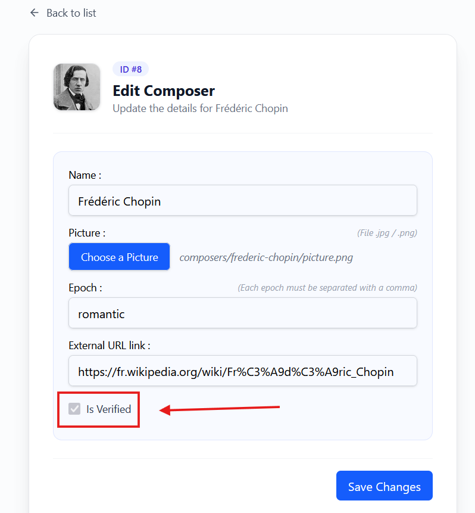

[← back](./summary.md)

# Composer

## Creation and Update

Everybody can create, or update a composer.

Once done the `(IsVerified)` is passed to `false`
For a normal user `(IsVerified)` is only a readable parameter !

Afterwards the operation has to be validated by the moderator

## Merge

## Delete
